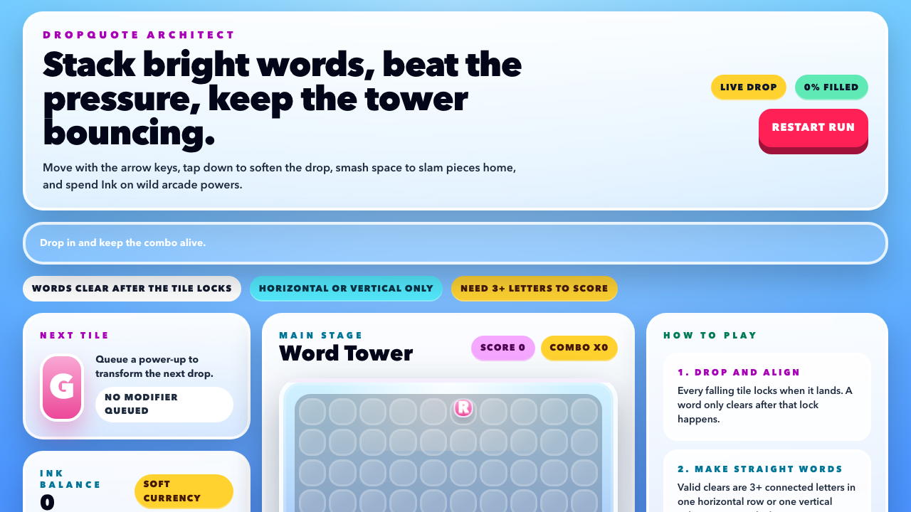

# 🏗️ DropQuote Architect

[](https://github.com/stonedhawk/DropQuote-Architect/actions/workflows/deploy-pages.yml)
[](https://opensource.org/licenses/MIT)
[](https://react.dev/)
[](https://redux-toolkit.js.org/)
[](https://tailwindcss.com/)
[](https://github.com/stonedhawk/game-ready-dictionary)

**DropQuote Architect** is a vibrant, fast-paced arcade word-building game. Support the structural integrity of your board as letters fall in real-time: lock falling tiles, clear horizontal/vertical paths by forming words, relieve rising tower pressure, and utilize powerful tactical abilities to stay alive!

---

## 🕹️ Live Demo

👉 **Play it right in your browser:** [https://stonedhawk.github.io/DropQuote-Architect/](https://stonedhawk.github.io/DropQuote-Architect/)

---

## 📸 Gameplay Preview



---

## ⚡ Powered by Game-Ready Dictionary

DropQuote Architect's word validation is backed by the [📚 game-ready-dictionary](https://github.com/stonedhawk/game-ready-dictionary) repository, an open-source, pre-compiled multi-tiered lexicon. 

### Why This Makes Gameplay Amazing:
- **Massive Vocabulary (~60,000 words):** Using the **Medium complexity tier Trie**, the game recognizes thousands of short, medium, and complex English words instantly, ensuring obvious words always count and gameplay feels incredibly fair and satisfying!
- **High-Performance Trie Engine:** Lookups are performed in $O(m)$ time (where $m$ is the word length) rather than searching through arrays. The validation runs at sub-millisecond speeds, keeping the high-frequency gameplay loop completely fluid at 60 FPS.
- **Bi-directional Support:** The engine scans for words both forward and backward, horizontally and vertically, allowing for strategic cross-scoring setups!

---

## 🎮 How To Play

### 🚀 30-Second Quick Start (Foolproof Guide)
If you've never played a word-building falling-block game before, here is the exact step-by-step to start scoring in **under 30 seconds**:
1. **Watch the falling tile:** A letter tile falls from the top of the board.
2. **Slide it into position:** Press the `Left / Right Arrow` keys (or tap a column on mobile) to align the tile with your target column.
3. **Lock the tile:** Let the tile land naturally or press `Spacebar` (double-tap on mobile) to instantly lock it down. It locks as soon as it lands on the bottom floor or on top of another letter.
4. **Form a straight word:** When the tile locks, the board scans for straight lines of **3 or more letters** vertically or horizontally (reading in both directions, e.g., `C-A-T` or `T-A-C`).
5. **Clear space & reduce pressure:** The matched word will clear, supported tiles will drop down, and your **Pressure** will decrease. Keep building words to prevent **Pressure from reaching 100%**!

### Core Gameplay Rules:
1. **Word Clears:** Words must read in a straight line (horizontal or vertical). Diagonal placements do not count.
2. **Cascades:** Support-free tiles will fall naturally after words are cleared, potentially triggering chain-reaction combos.
3. **Pressure Tower:** The run ends if the board's **Pressure reaches 100%**. Pressure rises as the board becomes denser with locked tiles, which also increases the falling speed!
4. **Ink Economy:** Clearing words earns **Ink**, a custom resource used to purchase powerful active abilities from your inventory.

---

## ⌨️ Controls

### Keyboard Layout
| Key | Action |
| :--- | :--- |
| `Left / Right Arrow` | Move active tile left/right |
| `Down Arrow` | Soft drop (faster fall speed) |
| `Spacebar` | Hard drop (instant lock) |
| `1`, `2`, `3` | Use power-up from slots 1, 2, or 3 |
| `C` | Discard/cancel the queued next-drop modifier |

### Touch Support (Mobile Optimized)
- **Tap a column:** Move the active tile directly toward that lane.
- **Swipe down:** Trigger a soft drop.
- **Double tap:** Trigger an instant hard drop.

---

## 🚀 Active Power-Ups

Clear words, accumulate **Ink**, and buy game-saving modifiers:

*   **🧱 Steel Beams (Slot 1):** Queues a reinforced tile. If cleared in a word, the entire row becomes fortified and pressure drops sharply!
*   **💥 Wrecking Ball (Slot 2):** Blasts through a selected column to clear space and give you critical breathing room.
*   **🔮 Mortar (Slot 3):** Turns the next dropping tile into a **Wildcard (`?`)** that resolves to any letter matching a dictionary word.

---

## 🛠️ Tech Stack & Architecture

*   **React 19 & TypeScript:** Strongly typed, modern UI layout.
*   **Vite:** Instant Hot Module Replacement (HMR) and ultra-fast builds.
*   **Redux Toolkit (RTK):** State management using entity adapters. The board state is managed as a collection of normalized tile entities rather than a standard 2D array, allowing high-frequency, predictable updates.
*   **Tailwind CSS v4:** Curated color schemes, sleek dark mode gradients, glassmorphism UI containers, and smooth CSS micro-animations.
*   **Vitest & React Testing Library:** Bulletproof unit, integration, and user-event test suite.

---

## 📁 Project Structure

```bash
├── .github/workflows     # CI/CD deployment pipelines
├── docs/images           # Promotional screenshots & assets
├── public/               # Static favicons, icons, and SVG assets
├── scripts/              # Build utilities for local development
└── src/
    ├── app/              # Typed hooks and Redux store configuration
    ├── assets/           # UI media assets
    ├── components/       # Board UI, Pressure HUD, and stats panels
    ├── data/             # Reference wordlists and asset templates
    ├── features/         # RTK slices (economy, pressure, session, tiles)
    ├── game/             # Pure gameplay logic, scanners, and math utilities
    ├── hooks/            # Keyboard inputs, audio triggers, and tick loops
    └── test/             # Vitest test files and setup
```

---

## 💻 Local Development

### 1. Install Dependencies
```bash
npm install
```

### 2. Start the Dev Server
```bash
npm run dev
```
Open [http://localhost:5173](http://localhost:5173) in your browser.

### 3. Run Test Suite
```bash
npm test
```

### 4. Build for Production
```bash
npm run build
```

---

## ⚖️ License

Code and systems are licensed under the **MIT License**.
Dictionary data layers are powered by the public domain **ENABLE1** list via `@rahulmrx/game-ready-dictionary`.
